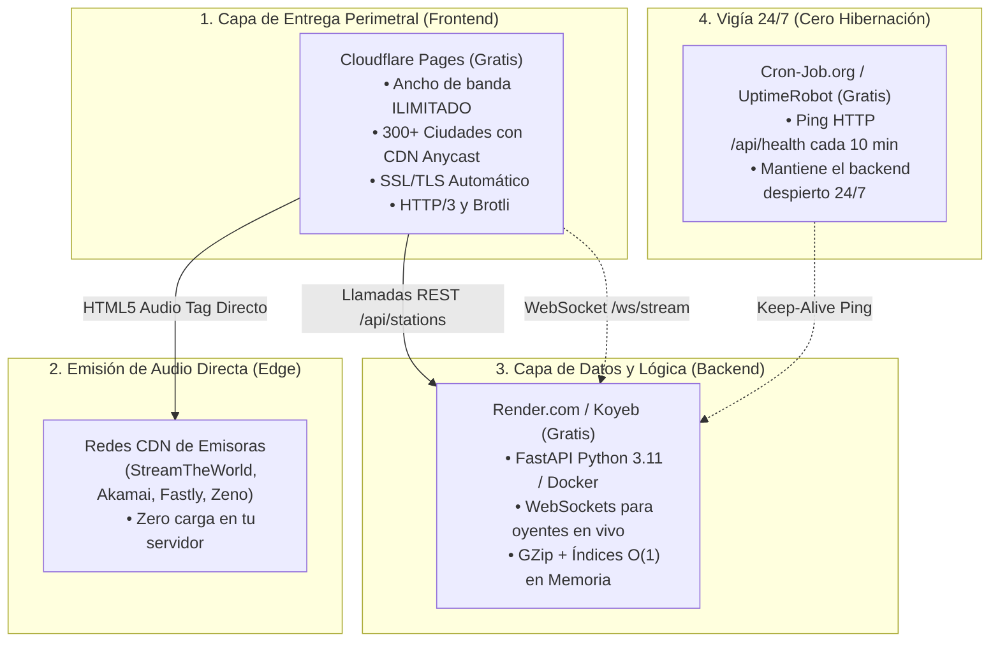

# 🚀 Guía de Despliegue en Servicios 100% Gratuitos y de Alta Calidad
## Radio Mundial — Arquitectura Hexagonal Hi-Fi Transistor Streaming
> **Autor:** Hugo Francisco Luis Inclan  
> **Copyright (c) 2026 Hugo Francisco Luis Inclan.** Todos los derechos reservados.  
> **Licencia:** MIT License.  
> **Costo Operativo Mensual:** **$0.00 USD / mes (100% Gratis de por vida)**.

---

## 📋 Resumen de la Infraestructura Gratuita

Para garantizar un rendimiento de nivel empresarial sin costo alguno, la solución se desacopla en dos servicios gratuitos líderes en la industria:



---

## 🛠️ PASO 1: Preparación del Repositorio en GitHub

1. Asegúrate de tener tu repositorio en GitHub (público o privado):
```bash
git remote add origin https://github.com/TU_USUARIO/Radio-Mundial.git
git branch -M master
git push -u origin master
```

---

## 🐍 PASO 2: Despliegue del Backend en Render.com (100% Gratis)

Render ofrece un nivel gratuito de servicios web (*Free Web Service*) con HTTPS automático y despliegue continuo desde GitHub.

### 2.1 Crear el Web Service en Render
1. Ve a [dashboard.render.com](https://dashboard.render.com/) e inicia sesión con tu cuenta de GitHub.
2. Haz clic en **"New +"** y selecciona **"Web Service"**.
3. Elige tu repositorio `Radio-Mundial` y haz clic en **Connect**.

### 2.2 Configuración del Servicio
Configura los siguientes campos:
* **Name:** `radio-mundial-api`
* **Region:** *Oregon (US West)* o *Frankfurt (EU)* (elige la más cercana a tu audiencia principal).
* **Branch:** `master`
* **Root Directory:** `backend`
* **Runtime:** `Python 3`
* **Build Command:**
  ```bash
  pip install --upgrade pip && pip install -r requirements.txt
  ```
* **Start Command:**
  ```bash
  uvicorn main:app --host 0.0.0.0 --port $PORT --workers 2
  ```
* **Instance Type:** `Free` (0.1 CPU, 512 MB RAM — *más que suficiente gracias a los índices O(1) y compresión GZip*).

### 2.3 Variables de Entorno (Environment Variables)
En la sección **"Environment Variables"**, agrega:
| Clave | Valor | Descripción |
| :--- | :--- | :--- |
| `PYTHONUNBUFFERED` | `1` | Salida inmediata de logs |
| `ALLOWED_ORIGINS` | `["*"]` o tu dominio de frontend | Soporte CORS para Blazor |
| `ENABLE_WARMUP` | `true` | Pre-calentamiento del catálogo al iniciar |

4. Haz clic en **"Create Web Service"**.
5. Render compilará tu aplicación en ~2 minutos y te otorgará tu URL pública segura:
   👉 `https://radio-mundial-api.onrender.com`

---

## ⚡ PASO 3: Mantener el Backend Activo 24/7 Gratis (Evitar Hibernación)

El tier gratuito de Render entra en reposo si no recibe peticiones en 15 minutos. Para evitar el retardo inicial (*cold start*), usa un monitor de uptime gratuito:

1. Ve a [cron-job.org](https://cron-job.org/) o [uptimerobot.com](https://uptimerobot.com/) y regístrate gratis.
2. Crea un nuevo monitor o Cron Job:
   * **URL:** `https://radio-mundial-api.onrender.com/api/health`
   * **Intervalo:** Cada **10 minutos**.
3. ¡Listo! El endpoint `/api/health` responderá `{"status": "ok"}` en menos de 5 ms y mantendrá tu backend 100% caliente y listo para los usuarios.

---

## 🌐 PASO 4: Despliegue del Frontend en Cloudflare Pages (100% Gratis)

Cloudflare Pages es la plataforma gratuita más rápida del mundo para aplicaciones WebAssembly (.NET WASM) con ancho de banda ilimitado y CDN en 300+ ciudades.

### Opción A: Despliegue Directo con GitHub (Recomendada)
1. Ve al panel de [dash.cloudflare.com](https://dash.cloudflare.com/) y accede a **Workers & Pages** -> **Create application** -> **Pages**.
2. Conecta tu cuenta de GitHub y selecciona el repositorio `Radio-Mundial`.
3. En la configuración de compilación (**Build settings**):
   * **Framework preset:** `None`
   * **Build command:**
     ```bash
     cd frontend && dotnet publish -c Release -o output
     ```
   * **Build output directory:** `frontend/output/wwwroot`
   * **Root directory:** `/` (o dejar vacío)
4. En **Environment variables**:
   * Agrega: `DOTNET_CLI_TELEMETRY_OPTOUT=1`
5. Haz clic en **"Save and Deploy"**.

### Opción B: Despliegue Rápido por CLI con Wrangler
Si prefieres compilar localmente y subir los archivos estáticos en 15 segundos:
```bash
# 1. Compilar el frontend en modo Release
cd frontend
dotnet publish -c Release -o dist

# 2. Publicar con Wrangler en Cloudflare Pages (gratis)
npx wrangler pages deploy dist/wwwroot --project-name radio-mundial
```
Cloudflare te otorgará tu URL instantánea:
👉 `https://radio-mundial.pages.dev`

---

## 🔗 PASO 5: Vincular Frontend con Backend en Producción

El frontend ya está programado en [`HttpRadioCatalogAdapter.cs`](file:///home/productdeath/Documentos/UNIVERSAL/PERSONAL/Radio-Mundial/frontend/Infrastructure/Adapters/HttpRadioCatalogAdapter.cs) para apuntar automáticamente a `https://radio-mundial-api.onrender.com` cuando se ejecuta fuera de `localhost`.

Si deseas configurar una URL personalizada en el frontend, puedes editar [`frontend/wwwroot/appsettings.json`](file:///home/productdeath/Documentos/UNIVERSAL/PERSONAL/Radio-Mundial/frontend/wwwroot/appsettings.json):
```json
{
  "BackendHttpUrl": "https://radio-mundial-api.onrender.com",
  "BackendWsUrl": "wss://radio-mundial-api.onrender.com/ws/stream"
}
```

---

## 🏷️ PASO 6: Configurar Dominio Personalizado Gratuito (Opcional)

Si tienes un dominio propio (ejemplo: `radiomundial.com`, `radiomundial.app`, etc.):
1. En **Cloudflare Pages**, ve a tu proyecto -> pestaña **Custom domains**.
2. Haz clic en **"Set up a custom domain"** e ingresa tu dominio.
3. Cloudflare configurará automáticamente los registros DNS y generará tu certificado **SSL/TLS universal gratuito** con renovación automática de por vida.

---

## 📈 PASO 7: Indexación en Primera Plana de Google y Bing (SEO Checklist)

Para que tu radio aparezca en los primeros lugares cuando busquen *"radio"*, *"radio mundial"*, *"radio en vivo"*, o emisoras por ciudad:

1. **Google Search Console ([search.google.com/search-console](https://search.google.com/search-console)):**
   * Agrega tu propiedad `https://radio-mundial.pages.dev/` (o tu dominio personalizado).
   * En el menú lateral, ve a **Sitemaps**.
   * Ingresa: `sitemap.xml` y haz clic en **Enviar**.
   * Ve a **Inspección de URLs**, escribe `https://radio-mundial.pages.dev/` y haz clic en **"Solicitar indexación"**.
2. **Bing Webmaster Tools ([bing.com/webmasters](https://www.bing.com/webmasters)):**
   * Importa tu sitio verificado desde Google Search Console con un solo clic.
   * Envía igualmente `sitemap.xml`.
3. **Verificación de Datos Estructurados (Rich Snippets):**
   * Prueba tu URL en la [Herramienta de Prueba de Resultados Enriquecidos de Google](https://search.google.com/test/rich-results).
   * Verás activos los esquemas `WebSite` (con caja de búsqueda integrada en Google), `WebApplication`, `Organization` y `BroadcastService`.

---

## ✅ Resumen de Beneficios de este Despliegue

| Característica | Proveedor | Costo |
| :--- | :--- | :---: |
| **Hosting Frontend WASM** | Cloudflare Pages | **$0.00** |
| **Ancho de Banda Frontend** | Ilimitado (Global Anycast) | **$0.00** |
| **Certificados SSL/TLS** | Cloudflare Edge / Let's Encrypt | **$0.00** |
| **Hosting Backend FastAPI** | Render.com Web Service | **$0.00** |
| **Base de Datos / Catálogo** | In-Memory con Particiones JSON | **$0.00** |
| **Keep-Alive 24/7** | Cron-Job.org / UptimeRobot | **$0.00** |
| **Ancho de Banda de Audio** | Directo de CDNs Broadcaster | **$0.00** |
| **COSTO TOTAL** | **100% Gratis de por vida** | **$0.00** |
