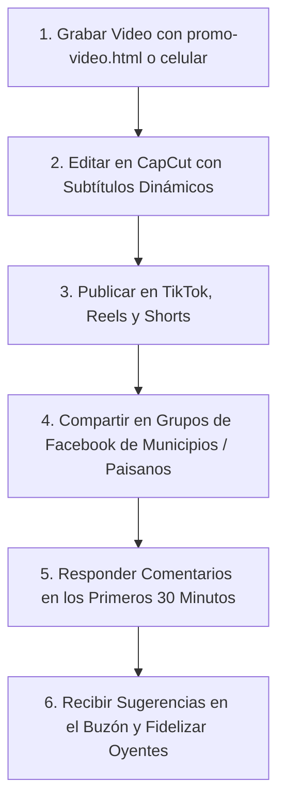

# 📻 Guía Maestra de Grabación, Guion y Video Promocional: Radio Mundial

> **Documento de Grabación Audiovisual, Storyboard y Guion de Locución Oficial**  
> **Proyecto:** *Radio Mundial — Sintonizador Global Hi-Fi de Transistor*  
> **Autor & Desarrollador:** Hugo Francisco Luis Inclan (`hugofranciscoluisinclan@gmail.com`)  
> **URL en Producción:** `https://radio-mundial.hugofranciscoluis.workers.dev/`  
> **Enlace de Donaciones Oficial (Stripe):** `https://donate.stripe.com/00w8wO7axb3E5GG1vt5Ne00`  
> **Herramienta de Animación en el Navegador:** `frontend/wwwroot/promo-video.html`  

---

## 📌 1. Resumen Ejecutivo del Proyecto: ¿Qué es Radio Mundial?

**Radio Mundial** es una plataforma web progresiva y sintonizador de radio interactivo de alta fidelidad que revive la experiencia táctil y nostálgica de los receptores analógicos a transistores de la década de 1970, combinada con un motor digital moderno capaz de conectar a los usuarios con más de **18,300 estaciones de radio en vivo de 232 países y territorios**.

### Pilares Técnicos y Propuesta de Valor:
1. **Estética Vintage Hi-Fi "Café Viejo":** Chasis simulado en madera de nogal pulido, bisel y perillas de latón dorado, cristal retroiluminado ámbar, aguja indicadora roja mecánica y medidor VU analógico reactivo al volumen.
2. **Cero Fricción para el Oyente:** No requiere registro de usuario, no exige descargar aplicaciones que saturen la memoria móvil, no tiene muros de pago ni pop-unders invasivos.
3. **Arquitectura Serverless de Alto Rendimiento:**
   - **Frontend:** Construido sobre **Blazor WebAssembly (.NET 9)** compilado a binario nativo de navegador, alojado en el borde global mediante **Cloudflare Workers**.
   - **Streaming:** Consumo directo de flujos de audio digital de alta fidelidad (Icecast, Shoutcast, HLS y AAC) con manejo de audio en segundo plano y reproducción persistente en móviles.
   - **Catálogo Global:** Base de datos geo-indexada con filtrado instantáneo por país, estado/provincia, género musical y frecuencia (AM/FM).

---

## ⏱️ 2. Estructura Cronológica del Video (Formato Corto Viral: 45 a 60 Segundos)

Esta estructura aplica la fórmula de retención algorítmica para TikTok, Instagram Reels, YouTube Shorts y Facebook Reels: **Gancho de 3 segundos + Demostración Visual + Revelación de Características + Llamado a la Acción**.

| Bloque | Tiempo | Sección en Pantalla | Qué Mostrar en la UI | Clave de Retención Algorítmica |
| :---: | :---: | :--- | :--- | :--- |
| **01** | `0:00 - 0:05` | **Gancho Inicial (Hook)** | Primer plano cerrado al dial ámbar. El cursor o el dedo toca el cristal y la **aguja roja se mueve con un sonido suave de estática** analógica que súbitamente sintoniza música clara. | Rompe el patrón visual del scroll de TikTok con un objeto vintage y sonido nostálgico. |
| **02** | `0:05 - 0:15` | **El Descubrimiento** | Abrir la toma: se aprecia el chasis completo de madera, la perilla giratoria y la antena. La aguja se desplaza de 88 a 104 MHz y cambia de estación en tiempo real. | Muestra el producto en acción inmediata: interacción táctil fluida. |
| **03** | `0:15 - 0:28` | **Catálogo y Búsqueda en Vivo** | Escribir en el buscador: *"Chiapas"*, luego *"España"*, luego *"Japón"*. Las tarjetas de radio se filtran al instante con sus frecuencias (AM/FM) y logotipos. | Genera curiosidad: la gente busca de inmediato su estado o ciudad natal. |
| **04** | `0:28 - 0:38` | **Cero Barreras & Vista Móvil** | Mostrar la pantalla del teléfono celular: sintonizador plegable ergonómico, reproductor flotante en la parte inferior y música sonando sin interrupciones. | Resuelve la objeción: *"¿Funciona en mi teléfono sin descargar nada?"* |
| **05** | `0:38 - 0:48` | **Crédito de Autor & Cierre** | Enfoque a la placa de latón: *"Hugo Francisco Luis Inclan — Creador"*. Texto dorado con la URL en pantalla y llamado a visitar el enlace en el perfil. | Humaniza el proyecto (desarrollador mexicano independiente) e impulsa tráfico. |

---

## 🎙️ 3. Guiones de Locución Palabra por Palabra

### Opción A: Guion Viral para TikTok / Instagram Reels / YouTube Shorts (45 Segundos)
*(Tono: Dinámico, entusiasta, cómplice y con ritmo rápido. Puedes grabarlo con tu propia voz o usar la voz en off de CapCut/TikTok).*

> **[0:00 - 0:05 | Hook]**  
> *"Guarda este video porque esta es una de esas páginas web que parecen completamente ilegales de conocer..."*
> 
> **[0:05 - 0:14 | La Revelación]**  
> *"Si te gusta la música o extrañas la nostalgia retro, desarrollé **Radio Mundial**: un sintonizador web analógico con diseño de radio a transistores de los años 70."*
> 
> **[0:14 - 0:27 | La Demostración]**  
> *"Tiene más de dieciocho mil trescientas estaciones de radio en riguroso directo de doscientos treinta y dos países. Puedes buscar por tu ciudad, estado o género: desde emisoras locales de México y Chiapas, hasta estaciones de Japón, España o Nueva York."*
> 
> **[0:27 - 0:37 | Las Ventajas]**  
> *"No te pide registrarte, no tienes que descargar aplicaciones que llenen tu memoria, no tiene popups molestos y funciona tanto en tu computadora como en tu celular en alta fidelidad."*
> 
> **[0:37 - 0:45 | Llamado a la Acción]**  
> *"Es cien por ciento gratis. El enlace directo te lo dejo en pantalla y en mi perfil: **radio-mundial.hugofranciscoluis.workers.dev**. ¡Entra a probarla y coméntame qué estación sintonizaste!"*

---

### Opción B: Guion Formal de Presentación y Portafolio Profesional (2 a 3 Minutos)
*(Ideal para YouTube, LinkedIn o presentaciones técnicas de ingeniería).*

> **[0:00 - 0:25 | Introducción]**  
> *"Hola a todos, mi nombre es Hugo Francisco Luis Inclan, desarrollador de software y creador de **Radio Mundial**.  
> En una época dominada por algoritmos de recomendación cerrados y plataformas de streaming saturadas de publicidad invasiva, se ha perdido la magia del descubrimiento radiofónico: la emoción de girar una perilla física, recorrer un dial analógico y encontrar señales vivas transmitiendo al otro lado del mundo en este mismo instante."*
> 
> **[0:25 - 0:55 | Arquitectura de Software]**  
> *"Para rescatar esta experiencia táctil con los estándares más exigentes de la web moderna, construí Radio Mundial sobre **Blazor WebAssembly en .NET 9**.  
> Toda la lógica de sintonización y renderizado corre en el cliente compilada a binario WASM, mientras que el despliegue está distribuido globalmente sobre la red perimetral de **Cloudflare Workers**. Esto nos permite entregar un tiempo de carga inicial ultrarrápido con costo de infraestructura cero y alta disponibilidad."*
> 
> **[0:55 - 1:40 | Demostración de Características]**  
> *"La interfaz rinde tributo a los sintonizadores de transistor de alta gama: incorpora una escala analógica interactiva sensible al clic y al arrastre, perilla volumétrica con potenciómetro visual, conmutación fluida entre bandas FM y AM, y un vúmetro dinámico.  
> Su motor de consulta filtra instantáneamente un catálogo curado de más de 18,300 frecuencias de 232 territorios, permitiendo a los paisanos sintonizar las radios de sus comunidades natales o explorar transmisiones exóticas con metadatos en tiempo real."*
> 
> **[1:40 - 2:15 | Adaptabilidad y Comunidad]**  
> *"El sistema implementa un diseño responsivo estricto con controles accesibles, reproductor de audio flotante persistente para navegación móvil y un módulo de buzón para que los mismos oyentes puedan solicitar la integración de nuevas estaciones locales.  
> Los invito a explorar la plataforma en **radio-mundial.hugofranciscoluis.workers.dev**. El proyecto es gratuito y abierto a la comunidad internacional. ¡Bienvenidos a la sintonía global!"*

---

### Opción C: Guion Ultra-Rápido para Estados / Stories (15 Segundos)

> *"¿Extrañas la radio clásica? Creé una radio vintage en internet con más de 18,000 estaciones de México y todo el mundo. Es 100% gratis y sin descargas. Link directo en mi perfil: ¡corre a probarla!"*

---

## 🎬 4. Grabador de Video Animado Automático (`promo-video.html`)

Para que no tengas que animar manualmente ni mover el cursor mientras grabas, creamos una herramienta automatizada lista para abrir en tu navegador:

### ¿Dónde está y cómo abrirla?
- Archivo local: [`frontend/wwwroot/promo-video.html`](file:///home/productdeath/Documentos/UNIVERSAL/PERSONAL/Radio-Mundial/frontend/wwwroot/promo-video.html)
- En línea: `https://radio-mundial.hugofranciscoluis.workers.dev/promo-video.html`

### Funciones y Atajos de Teclado del Grabador:
1. **`▶ Iniciar Animación (45s)` (o Barra Espaciadora):** Inicia una secuencia cinematográfica coreografiada de 45 segundos:
   - Emite sonido analógico de sintonización y estática realista sintetizado por Web Audio API.
   - Desplaza la aguja roja automáticamente por la escala FM.
   - Sintoniza secuencialmente: *Los 40 México*, *Radio Chiapas (Marimba Estéreo)*, *Cadena SER España* y *Tokyo FM*.
   - El vúmetro rebota al ritmo del audio.
   - Muestra subtítulos dinámicos dorados sincronizados palabra por palabra con el Guion Viral.
2. **`📱 Formato: Vertical (9:16) / Horizontal (16:9)`:** Cambia el aspecto de la pantalla con un solo clic para grabar directamente para TikTok (vertical) o YouTube (horizontal).
3. **`🎬 Modo Grabación Limpia (F11)`:** Oculta todos los botones del panel de control para que solo se vea la radio retro y los subtítulos elegantes durante la grabación. Presiona `Esc` para salir.
4. **`🔄 Reiniciar` (o Tecla R):** Reinicia el cronómetro y la aguja al inicio.

---

## 🧠 5. Preguntas Frecuentes y Respuestas Técnicas (Para Comentarios en Redes)

Cuando publiques el video, muchas personas te harán preguntas en los comentarios. Aquí tienes las respuestas exactas:

* **Pregunta:** *"¿Cómo le haces para transmitir tantas estaciones si tener un servidor de radio cuesta mucho dinero?"*  
  **Respuesta:** *"Radio Mundial no retransmite el audio desde un servidor propio; se conecta directamente a los enlaces de streaming oficiales de cada emisora (Icecast/Shoutcast/HLS). Mi plataforma actúa como el sintonizador inteligente que organiza, busca y decodifica el audio en el navegador del usuario."*

* **Pregunta:** *"¿Por qué usaste Blazor WebAssembly en lugar de React o JavaScript normal?"*  
  **Respuesta:** *"Porque Blazor WebAssembly permite ejecutar código C# directamente en el motor del navegador compilado a WebAssembly. Esto ofrece un rendimiento altísimo al manejar catálogos de miles de registros en memoria sin retardos y con tipado estricto."*

* **Pregunta:** *"¿Por qué algunas estaciones tardan 2 segundos en sonar?"*  
  **Respuesta:** *"Depende del buffer del servidor de la estación emisora y de la velocidad de conexión del usuario. La mayoría de los streams en CDN conectan de manera casi instantánea."*

* **Pregunta:** *"¿Puedo pedir que agreguen la radio de mi municipio?"*  
  **Respuesta:** *"¡Claro que sí! En la esquina superior derecha de la página hay un botón de 'Buzón / Sugerir Estación'. Déjame el nombre y la ciudad y la agregamos en la siguiente actualización."*

---

## 📋 6. Copys y Textos Listos para Publicar en Redes Sociales

### Para TikTok / Instagram Reels / YouTube Shorts:
```text
📻 ¿Extrañas la magia de la radio analógica? Desarrollé un sintonizador retro en la web con más de 18,300 estaciones de radio en vivo de todo el mundo 🌎🇲🇽

✨ Dial analógico interactivo con aguja de sintonización
✨ Cero registros, sin descargas y sin publicidad invasiva
✨ Busca tu estado, municipio, país o género favorito
✨ Sonido estéreo de alta fidelidad en celular y computadora

Pruébalo gratis aquí:
👉 https://radio-mundial.hugofranciscoluis.workers.dev/
(Enlace directo disponible en mi perfil)

#radiomundial #radiovintage #paginasweb #musica #tecnologia #mexico #chiapas #radioenvivo #desarrolloweb #nostalgia #retro
```

### Para Grupos de Facebook (Comunidades Locales, Paisanos en EE.UU., Música del Recuerdo):
```text
¡Hola a todos! 👋 Les comparto un proyecto independiente que desarrollé con mucho cariño y que es 100% gratuito para toda la comunidad:

Se llama Radio Mundial (https://radio-mundial.hugofranciscoluis.workers.dev/). Es una página con diseño de radio retro de madera donde puedes sintonizar en vivo miles de estaciones de radio de México (Chiapas, Oaxaca, CDMX, Jalisco, etc.) y de más de 200 países.

Ideal para poner música mientras trabajan, estudian o para los paisanos que están lejos de su tierra y quieren escuchar las noticias y la música de su pueblo natal. No pide registrarse ni instalar nada. ¡Espero que les traiga muchos buenos recuerdos! 📻🎶
```

### Para LinkedIn (Enfoque Profesional de Ingeniería de Software):
```text
📻 Emocionado de presentar Radio Mundial: una aplicación web progresiva construida con Blazor WebAssembly (.NET 9) y desplegada en la red perimetral de Cloudflare Workers.

El objetivo fue combinar el diseño de interfaces táctiles con la potencia del cómputo cliente en el navegador:
🔹 Catálogo en memoria de +18,300 estaciones de radio en vivo de 232 países.
🔹 Sintonizador analógico interactivo modelado con CSS 3D y Web Audio API.
🔹 Tiempo de carga sub-segundo con coste de hosting de $0 USD gracias a la arquitectura serverless en Cloudflare Workers y Render.
🔹 Diseño adaptable optimizado para dispositivos móviles y escritorio.

👉 Pueden probar la versión en producción aquí: https://radio-mundial.hugofranciscoluis.workers.dev/
Repositorio: https://github.com/IDS-HUGO/Radio-Mundial

#SoftwareEngineering #DotNet #Blazor #WebAssembly #CloudflareWorkers #Frontend #WebDevelopment #RadioMundial
```

---

## 🚀 7. Plan de Lanzamiento y Crecimiento Orgánico Gratuito



1. **Horarios de Mayor Impacto (Hora Centro de México):**
   - **Mediodía:** 1:00 PM a 3:30 PM (hora de comida y descanso).
   - **Noche:** 7:30 PM a 10:00 PM (mayor tráfico activo en TikTok e Instagram).
2. **Los Primeros 30 Minutos son Cruciales:** En cuanto alguien comente *"¿Está la estación de Chiapas?"* o *"¿Cómo se llama la canción?"*, responde de inmediato. El algoritmo premia los videos con conversación activa y los empuja a la pestaña *"Para Ti"*.
3. **Llamado al Buzón:** Invitar a la gente a pedir sus estaciones crea un vínculo de lealtad: el usuario regresa a la web para escuchar la emisora que él mismo pidió.
