# 📻 Radio Mundial — High-Fidelity Global Transistor Radio

[](LICENSE)
[](https://dotnet.microsoft.com/)
[](https://python.org/)
[](https://fastapi.tiangolo.com/)
[](https://blazor.net/)
[](https://www.docker.com/)

> **Autor:** Hugo Francisco Luis Inclan  
> **Copyright (c) 2026 Hugo Francisco Luis Inclan.** Todos los derechos reservados.  
> **Licencia:** MIT License.

---

## 📖 Descripción General

**Radio Mundial** es una plataforma moderna de sintonización y transmisión de audio en vivo de alta fidelidad (Hi-Fi) que combina la elegancia analógica de una radio de transistores clásica de los años 70 (**estilo "Café Viejo"**) con la potencia del desarrollo web contemporáneo.

Diseñada bajo los estándares más exigentes de la industria con **Arquitectura Limpia (Clean Architecture)** y **Arquitectura Hexagonal (Ports & Adapters)**, tanto en el backend como en el frontend, ofrece una experiencia reactiva, modular, resiliente, preparada para alta concurrencia masiva y optimizada para el posicionamiento orgánico número 1 en motores de búsqueda (SEO) al buscar *"radio"*, *"radio mundial"*, *"radio en vivo"* o emisoras por ciudad.

### 📚 Documentación Técnica Detallada:
* 🚀 **[Guía de Despliegue 100% Gratuito (Cloudflare Pages + Render)](GUIA_DESPLIEGUE_FREE.md)**
* ⚙️ **[Documentación Técnica del Backend (FastAPI Hexagonal)](backend/README.md)**
* 🖥️ **[Documentación Técnica del Frontend (Blazor WebAssembly .NET 10)](frontend/README.md)**

---

## 🏛️ Arquitectura Hexagonal y Limpia (Ports & Adapters)

Tanto el backend en **FastAPI** como el frontend en **Blazor WebAssembly (.NET 10)** implementan la separación estricta de responsabilidades:

```mermaid
graph TD
    subgraph Dominio ["1. Dominio (Core)"]
        E1[Station Entity]
        E2[TrackMetadata Entity]
        E3[RadioBroadcastMessage Entity]
        E4[FilterOptions Entity]
        E5[Domain Exceptions]
    end

    subgraph Aplicacion ["2. Aplicación (Puertos y Casos de Uso)"]
        P1["Puerto: IStationRepository"]
        P2["Puerto: IBroadcaster"]
        P3["Puerto: IAudioPlayerPort"]
        P4["Puerto: IPreferencesPort"]
        P5["Puerto: ITranslationPort"]
        UC1[GetStationsUseCase]
        UC2[GetFiltersUseCase]
        UC3[GetStationByIdUseCase]
        UC4[BroadcastStateUseCase]
        AS[RadioStateService Coordinador]
    end

    subgraph Infraestructura ["3. Infraestructura (Adaptadores)"]
        AD1["Adaptador: InMemoryStationRepository (Índices O1)"]
        AD2["Adaptador: WebSocketBroadcaster (asyncio.gather)"]
        AD3["Adaptador: RestApiController (Caché RFC 9111)"]
        AD4["Adaptador: HttpRadioCatalogAdapter (HttpClient)"]
        AD5["Adaptador: JsAudioPlayerAdapter (HTML5 Audio Bridge)"]
        AD6["Adaptador: JsPreferencesAdapter (Cookies & LocalStorage)"]
        AD7["Adaptador: ClientWebSocketAdapter (Backoff Resiliente)"]
        AD8["Adaptador: DictionaryTranslationAdapter (ES / EN)"]
    end

    subgraph Presentacion ["4. Presentación (Blazor UI)"]
        UI1["Páginas: Home.razor (Cockpit Paginado 60 FPS)"]
        UI2["Componentes: RetroRadio.razor ('Café Viejo' / Aguja Móvil)"]
        UI3["Componentes: RadioPlayer.razor"]
        UI4["Componentes: CookieConsent.razor"]
    end

    Dominio --> Aplicacion
    Aplicacion --> Infraestructura
    Infraestructura --> Presentacion
```



---

## ✨ Características Principales

### 📻 1. Estética Vintage "Café Viejo"
* **Chasis Caoba/Nogal:** Degradado multicapa con vetas satinadas (`#442413` a `#170904`).
* **Bisel de Latón Envejecido:** Acabado metálico cepillado (`#c5a059`).
* **Rejilla Acústica:** Textura de lino y arpillera entrelazada (`#dfd2be` a `#cebd9f`) con lamas de resonancia.
* **Dial con Aguja Móvil Real:** Indicador carmesí con cálculo trigonométrico que viaja con suavidad sobre la frecuencia exacta al sintonizar.
* **Nuevos Logotipos Oficiales:**
  * `frontend/wwwroot/img/radio-mundial-icono.svg`: Ícono vectorial SVG con dial y aguja en madera y latón.
  * `frontend/wwwroot/img/radio-mundial-logo-horizontal.png`: Banner de alta definición 2100x660 para OpenGraph y redes sociales.

### ⚡ 2. Soporte Físico FM y AM
* **FM (88.0 – 108.0 MHz):** Alta fidelidad estéreo cristalina (15 kHz), inmune a ruidos de tormentas.
* **AM (540 – 1600 kHz):** Señal de largo alcance con rebote ionosférico nocturno, ideal para noticias y áreas rurales.
* **Interruptor Frontal:** Conmutador físico de palanca en la radio para alternar entre FM y AM.
* **Guía Educativa Interactiva:** Tarjeta desplegable que explica la física de propagación de ondas.

### 🌾 3. Matías Romero, Chiapas, Oaxaca y Cobertura Mundial 100% (223 Países)
* **Tapachula, Chiapas (100% Verificado):**
  * **Extremo 96.3 FM Tapachula** (*XHHTS / SonicPanel Icecast HD* en `https://stream.freepi.io/8310/live`).
  * **W Radio 1000 AM Tapachula** (`https://streaming.servicioswebmx.com/8248/stream`).
  * **Bella Música 106.7 FM Tapachula** (`https://stream.zeno.fm/scdv0t33gd0uv`).
  * **Los 40 Tapachula 99.5 FM** (`https://stream.freepi.io/8300/live`).
* **Tuxtla Gutiérrez y Costa de Chiapas:** Radio Chiapas 93.9 FM, Joya 101.7 FM, La Poderosa 91.1 FM, Bella Música 93.1 FM y Digital 89.5 FM Tonalá.
* **La Ke Buena 90.5 FM Matías Romero (XHYG-FM):** Emisora destacada con 25,000 W de potencia transmitiendo en vivo para el Istmo de Tehuantepec.
* **Catálogo Oaxaqueño Completo:** La Voz del Ángel 650 AM (Puerto Ángel), Hits 100.1 FM y La Mejor 105.3 FM (Huajuapan), Encuentro 90.1 FM (Juchitán), Encuentro 98.1 FM (Pinotepa Nacional), La Poderosa 100.1 FM, La Mexicana 94.9 FM, Los 40 89.7 FM, W Radio 95.7 FM y La Mejor 101.7 FM (Oaxaca de Juárez).
* **Los 32 Estados de México y Cobertura Planetaria:** 3,575+ emisoras activas en 223 países y territorios a lo largo de los 5 continentes (América, Europa, Asia, África y Oceanía).

### 🚀 4. Arquitectura de Ultra Alta Concurrencia (Miles de Oyentes Simultáneos)
* **Streaming Directo CDN Edge (Zero Server Bottleneck):** Los flujos de audio se transmiten directamente desde redes perimetrales globales (StreamTheWorld, Akamai, Fastly, Cloudflare, Zeno Media) al elemento HTML5 `<audio>` del navegador del usuario. El servidor backend no proxifica bytes binarios de audio, lo que permite escalar a millones de oyentes simultáneos sin degradar la CPU ni el ancho de banda.
* **Compresión GZip Integrada:** Middleware ASGI de compresión que reduce el tamaño de las cargas JSON de la API en un 85-90% (de ~1.8 MB a ~110 KB).
* **Caché Perimetral (Cache-Control RFC 9111):** Endpoints REST con directivas `public, max-age=1800, s-maxage=86400, stale-while-revalidate=600`, permitiendo que CDNs (Cloudflare, Fastly) y navegadores sirvan respuestas instantáneas en 0 ms desde el edge.
* **Índices de Repositorio O(1):** Estructuras indexadas secundarias en memoria (`_by_continent`, `_by_country`, `_by_band`) para consultas instantáneas en menos de 0.1 milisegundos bajo miles de solicitudes por segundo.
* **Difusión WebSocket Concurrente:** Difusión masiva paralela no bloqueante con `asyncio.gather` y timeouts individuales, evitando retrasos en el bucle de eventos.
* **Paginación Virtual Progresiva en Blazor:** El cliente renderiza lotes iniciales de 48 estaciones manteniendo un DOM ligero (< 600 nodos), garantizando 60 FPS estables al desplazarse en dispositivos móviles y de escritorio.

### 🔍 5. Estrategia de SEO para Primera Plana en Google y Bing
* **JSON-LD Schema.org Completo:** Marcas ricas de `WebSite`, `SearchAction` (cuadro de búsqueda de Google integrado), `WebApplication`, `Organization` y servicios de transmisión localizados.
* **Sitemap XML Dinámico (`sitemap.xml`):** Indexación de rutas por continente, país, estado, ciudad y banda.
* **Directivas de Rastreo (`robots.txt`):** Optimizado para Googlebot, Bingbot, Applebot, DuckDuckBot y YandexBot.
* **HTML5 MediaSession API:** Control nativo de reproducción y metadatos en la pantalla de bloqueo y notificaciones de Android, iOS, Windows y macOS.

---

## 📂 Estructura del Proyecto

```
Radio-Mundial/
├── LICENSE                          # Licencia MIT de Hugo Francisco Luis Inclan
├── README.md                        # Documentación general del proyecto
├── GUIA_DESPLIEGUE_FREE.md          # 🚀 Guía paso a paso para despliegue 100% gratis
├── docker-compose.yml               # Orquestación de producción Docker
│
├── backend/                         # Backend FastAPI (Arquitectura Hexagonal)
│   ├── README.md                    # Documentación técnica completa del backend
│   ├── domain/                      # Capa 1: Entidades y reglas de negocio puras
│   ├── application/                 # Capa 2: Casos de uso y puertos abstractos
│   ├── infrastructure/              # Capa 3: Adaptadores (repositorio O(1), WS, REST)
│   ├── data/                        # Particiones modulares por continente y semillas
│   ├── main.py                      # Composition Root (Inyección de Dependencias)
│   ├── Dockerfile                   # Imagen Docker Python Slim
│   └── requirements.txt
│
└── frontend/                        # Frontend Blazor WebAssembly .NET 10
    ├── README.md                    # Documentación técnica completa del frontend
    ├── Domain/                      # Entidades de dominio (Station, TrackMetadata)
    ├── Application/                 # Puertos y RadioStateService
    ├── Infrastructure/              # Adaptadores (Audio JSInterop, WebSocket, HTTP)
    ├── Components/                  # Componentes Razor (RetroRadio, RadioPlayer)
    ├── Pages/Home.razor             # Vista Principal Cockpit con filtros dinámicos
    └── wwwroot/                     # Activos estáticos, nuevos logos, sitemap y robots
```

---

## 🚀 Guía Rápida de Ejecución Local

### Backend (FastAPI):
```bash
cd backend
./venv/bin/python -m uvicorn main:app --host 0.0.0.0 --port 8000 --reload
```
*API y Documentación interactiva disponibles en:* `http://localhost:8000/docs`

### Frontend (Blazor WASM):
```bash
cd frontend
dotnet run
```
*Aplicación web en vivo disponible en:* `http://localhost:5296`

---

## 📜 Licencia y Autoría

Este proyecto es software de código abierto distribuido bajo los términos de la **Licencia MIT**.

* **Autor:** [Hugo Francisco Luis Inclan](https://github.com/productdeath)
* **Copyright:** © 2026 Hugo Francisco Luis Inclan. Todos los derechos reservados.

Consulta el archivo [LICENSE](LICENSE) para más detalles.
