# 📻 Radio Mundial — High-Fidelity Global Transistor Radio

[](LICENSE)
[](https://dotnet.microsoft.com/)
[](https://python.org/)
[](https://fastapi.tiangolo.com/)
[](https://blazor.net/)
[](https://www.docker.com/)

> **Autor:** Hugo Francisco Luis Inclan  
> **Copyright (c) 2026 Hugo Francisco Luis Inclan.** Todos los derechos reservados.  
> **Licencia:** MIT License.

---

## 📖 Descripción General

**Radio Mundial** es una plataforma moderna de sintonización y transmisión de audio en vivo de alta fidelidad (Hi-Fi) que combina la elegancia analógica de una radio de transistores clásica de los años 70 (**estilo "Café Viejo"**) con la potencia del desarrollo web contemporáneo.

Diseñada bajo los estándares más exigentes de la industria con **Arquitectura Limpia (Clean Architecture)** y **Arquitectura Hexagonal (Ports & Adapters)**, tanto en el backend como en el frontend, ofrece una experiencia reactiva, modular, resiliente y optimizada para el posicionamiento orgánico número 1 en motores de búsqueda (SEO).

---

## 🏛️ Arquitectura Hexagonal y Limpia (Ports & Adapters)

Tanto el backend en **FastAPI** como el frontend en **Blazor WebAssembly (.NET 10)** implementan la separación estricta de responsabilidades:

```mermaid
graph TD
    subgraph Dominio ["1. Dominio (Core)"]
        E1[Station Entity]
        E2[TrackMetadata Entity]
        E3[RadioBroadcastMessage Entity]
        E4[FilterOptions Entity]
        E5[Domain Exceptions]
    end

    subgraph Aplicacion ["2. Aplicación (Puertos y Casos de Uso)"]
        P1["Puerto: IStationRepository"]
        P2["Puerto: IBroadcaster"]
        P3["Puerto: IAudioPlayerPort"]
        P4["Puerto: IPreferencesPort"]
        P5["Puerto: ITranslationPort"]
        UC1[GetStationsUseCase]
        UC2[GetFiltersUseCase]
        UC3[GetStationByIdUseCase]
        UC4[BroadcastStateUseCase]
        AS[RadioStateService Coordinador]
    end

    subgraph Infraestructura ["3. Infraestructura (Adaptadores)"]
        AD1["Adaptador: InMemoryStationRepository (RadioBrowser + Seed)"]
        AD2["Adaptador: WebSocketBroadcaster (FastAPI WS)"]
        AD3["Adaptador: RestApiController (FastAPI Router)"]
        AD4["Adaptador: HttpRadioCatalogAdapter (HttpClient)"]
        AD5["Adaptador: JsAudioPlayerAdapter (HTML5 Audio Bridge)"]
        AD6["Adaptador: JsPreferencesAdapter (Cookies & LocalStorage)"]
        AD7["Adaptador: ClientWebSocketAdapter (Backoff Resiliente)"]
        AD8["Adaptador: DictionaryTranslationAdapter (ES / EN)"]
    end

    subgraph Presentacion ["4. Presentación (Blazor UI)"]
        UI1["Páginas: Home.razor (Cockpit / Filtros sin scroll)"]
        UI2["Componentes: RetroRadio.razor ('Café Viejo' / Aguja Móvil)"]
        UI3["Componentes: RadioPlayer.razor"]
        UI4["Componentes: CookieConsent.razor"]
    end

    Dominio --> Aplicacion
    Aplicacion --> Infraestructura
    Infraestructura --> Presentacion
```



### Principios Arquitectónicos Aplicados:
1. **Independencia de Frameworks:** Las entidades de dominio no conocen a FastAPI ni a Blazor.
2. **Inversión de Dependencias (DIP):** Los casos de uso dependen exclusivamente de interfaces/puertos abstractos (`IStationRepository`, `IBroadcaster`, `IAudioPlayerPort`, etc.).
3. **Mantenibilidad Extrema:** Sin archivos monstruosos ni código espagueti. Módulos compactos y cohesivos.
4. **Alta Testabilidad:** Facilidad absoluta para sustituir adaptadores reales por Mocks en pruebas unitarias.

---

## ✨ Características Principales

### 📻 1. Estética Vintage "Café Viejo"
* **Chasis Caoba/Nogal:** Degradado multicapa con vetas satinadas (`#442413` a `#170904`).
* **Bisel de Latón Envejecido:** Acabado dorado metálico cepillado (`#c5a059`).
* **Rejilla Acústica:** Textura de lino y arpillera entrelazada (`#dfd2be` a `#cebd9f`) con lamas de resonancia.
* **Dial con Aguja Móvil Real:** Indicador carmesí con cálculo trigonométrico que viaja con suavidad sobre la frecuencia exacta al sintonizar.

### ⚡ 2. Soporte Físico FM y AM
* **FM (88.0 – 108.0 MHz):** Alta fidelidad estéreo cristalina (15 kHz), inmune a ruidos de tormentas. La aguja se alinea en la escala superior.
* **AM (540 – 1600 kHz):** Señal de largo alcance con rebote ionosférico nocturno (onda celeste), ideal para noticias y áreas rurales. La aguja se alinea en la escala inferior.
* **Interruptor Frontal:** Conmutador físico de palanca en la radio para alternar entre FM y AM.
* **Guía Educativa Interactiva:** Tarjeta desplegable que explica al usuario la física de propagación de ondas.

### 🌾 3. Matías Romero y Cobertura Integral de Oaxaca
* **La Ke Buena 90.5 FM Matías Romero (XHYG-FM):** Emisora destacada con 25,000 W de potencia transmitiendo en vivo para el Istmo de Tehuantepec.
* **Catálogo Oaxaqueño Completo:** La Voz del Ángel 650 AM (Puerto Ángel), Hits 100.1 FM y La Mejor 105.3 FM (Huajuapan), Encuentro 90.1 FM (Juchitán), Encuentro 98.1 FM (Pinotepa Nacional), La Poderosa 100.1 FM, La Mexicana 94.9 FM, Los 40 89.7 FM, W Radio 95.7 FM y La Mejor 101.7 FM (Oaxaca de Juárez).
* **Los 32 Estados de México y Cobertura Mundial:** Ciudad de México, Jalisco, Nuevo León, Chiapas, Puebla, Veracruz, USA, Colombia, España, Argentina, etc.

### 🎯 4. UI/UX Senior: Cero Deslizamientos Tediosos
* Se eliminó el molesto scroll horizontal. Ahora cuentas con:
  * **Selector Desplegable Inmediato:** Acceso directo a los 32 estados de la República Mexicana en un clic.
  * **Matriz de Pastillas Adaptables (`flex-wrap`):** Botones organizados limpiamente sin desbordamiento.
  * **Pastilla Rápida de Oaxaca:** Acceso con un solo clic: `🌾 Oaxaca (Matías Romero 90.5 FM)`.

### 🌙 5. Adaptabilidad de Tema y Soporte Bilingüe
* **Conmutador de Tema:** `🌙 Oscuro` (Estudio Caoba), `☀️ Claro` (Pergamino Cálido) y `💻 Sistema` (Detección automática mediante `prefers-color-scheme`).
* **Internacionalización:** Conmutador `ES` / `EN` con diccionario reactivo para visitantes de cualquier parte del mundo.

### 🔍 6. Estrategia de SEO para Primera Plana en Google y Bing
* **JSON-LD Schema.org Completo:** Marcas ricas de `WebSite`, `SearchAction` (cuadro de búsqueda de Google integrado), `Organization` y servicios de transmisión localizados para Matías Romero, Oaxaca y CDMX.
* **Sitemap XML Dinámico (`sitemap.xml`):** Indexación de rutas por ciudad, estado, país y banda.
* **Directivas de Rastreo (`robots.txt`):** Configurado para Googlebot y Bingbot.
* **HTML5 MediaSession API:** Control nativo de reproducción y metadatos en la pantalla de bloqueo y notificaciones de Android, iOS, Windows y macOS.

---

## 📂 Estructura del Proyecto

```
Radio-Mundial/
├── LICENSE                          # Licencia MIT de Hugo Francisco Luis Inclan
├── README.md                        # Documentación técnica completa
├── docker-compose.yml               # Orquestación de producción Docker
│
├── backend/                         # Backend FastAPI (Arquitectura Hexagonal)
│   ├── domain/                      # Capa 1: Entidades y reglas de negocio puras
│   │   ├── entities.py              # Station, TrackMetadata, FilterOptions, etc.
│   │   └── exceptions.py            # Excepciones de dominio
│   ├── application/                 # Capa 2: Casos de uso y puertos abstractos
│   │   ├── ports/                   # IStationRepository, IBroadcaster
│   │   └── use_cases/               # GetStationsUseCase, BroadcastStateUseCase, etc.
│   ├── infrastructure/              # Capa 3: Adaptadores externos y configuración
│   │   ├── config/settings.py       # Pydantic BaseSettings
│   │   └── adapters/
│   │       ├── repositories/        # InMemoryStationRepository (RadioBrowser + Seed)
│   │       ├── broadcasters/        # WebSocketBroadcaster (Async Locks)
│   │       └── controllers/         # REST API y WebSocket Endpoints
│   ├── data/seed_stations.json      # Semilla curada de emisoras verificadas
│   ├── main.py                      # Composition Root (Inyección de Dependencias)
│   ├── Dockerfile                   # Imagen multi-stage Python 3.11 Slim
│   └── requirements.txt
│
└── frontend/                        # Frontend Blazor WebAssembly .NET 10
    ├── Domain/Entities/             # Entidades de dominio (Station, UserPreferences)
    ├── Application/
    │   ├── Ports/                   # IRadioCatalogPort, IAudioPlayerPort, etc.
    │   └── Services/RadioStateService.cs  # Coordinador de estado de la aplicación
    ├── Infrastructure/Adapters/     # Adaptadores concretos (JSInterop, HTTP, WS)
    ├── Components/                  # Componentes Razor (RetroRadio, RadioPlayer)
    ├── Pages/Home.razor             # Vista Principal Cockpit con filtros dinámicos
    ├── wwwroot/
    │   ├── css/app.css              # Variables de tema Café Viejo
    │   ├── js/radioAudio.js         # Audio Bridge y HTML5 MediaSession
    │   ├── sitemap.xml              # Mapa de sitio para indexación en Google
    │   ├── robots.txt               # Directivas SEO para motores de búsqueda
    │   └── sample-data/stations.json
    ├── Dockerfile                   # Compilación SDK 10 + Nginx Alpine
    ├── nginx.conf                   # Servidor de alta velocidad con Gzip y Cache
    └── Program.cs                   # Registro de Contenedor IoC / DI
```

---

## 🚀 Guía de Ejecución Local

### 1. Requisitos Previos
* **Python:** 3.11 o superior.
* **.NET SDK:** 10.0 instalado.
* **Docker & Docker Compose:** (Opcional para despliegue en contenedores).

---

### 2. Ejecución con Terminal `fish` (O cualquier shell)

#### Terminal 1 — Backend (FastAPI):
```fish
cd /home/productdeath/Documentos/UNIVERSAL/PERSONAL/Radio-Mundial/backend
./venv/bin/python -m uvicorn main:app --host 0.0.0.0 --port 8000 --reload
```
*API y Documentación interactiva disponibles en:* `http://localhost:8000/docs`

#### Terminal 2 — Frontend (Blazor WASM):
```fish
cd /home/productdeath/Documentos/UNIVERSAL/PERSONAL/Radio-Mundial/frontend
dotnet run --no-build
```
*Aplicación web en vivo disponible en:* `http://localhost:5296`

---

## 🐳 Despliegue con Docker Compose (Producción)

Para desplegar la solución completa en un servidor en la nube (AWS, DigitalOcean, VPS o local):

```bash
docker compose up -d --build
```

* **Frontend (Nginx Producción):** `http://localhost:5000`
* **Backend (FastAPI Uvicorn):** `http://localhost:8000`

---

## ☁️ Despliegue en Cloudflare Pages / Vercel

El frontend está optimizado para publicarse de forma estática en **Cloudflare Pages**:
```bash
cd frontend
dotnet publish -c Release -o output
# Los archivos listos para CDN se encuentran en output/wwwroot
```

---

## 📜 Licencia y Autoría

Este proyecto es software de código abierto distribuido bajo los términos de la **Licencia MIT**.

* **Autor:** [Hugo Francisco Luis Inclan](https://github.com/productdeath)
* **Copyright:** © 2026 Hugo Francisco Luis Inclan. Todos los derechos reservados.

Consulta el archivo [LICENSE](LICENSE) para más detalles.
